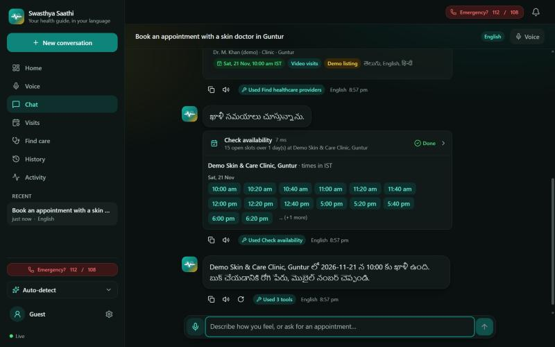
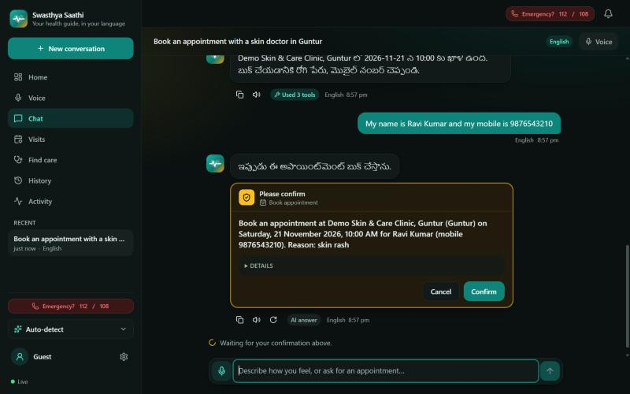
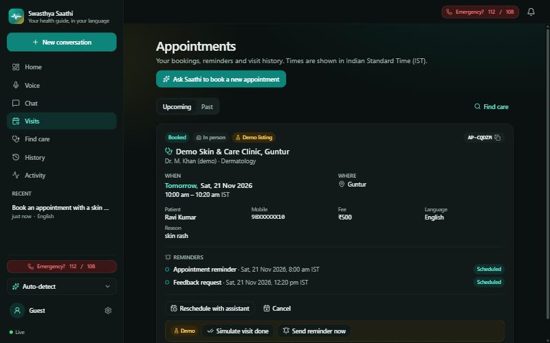
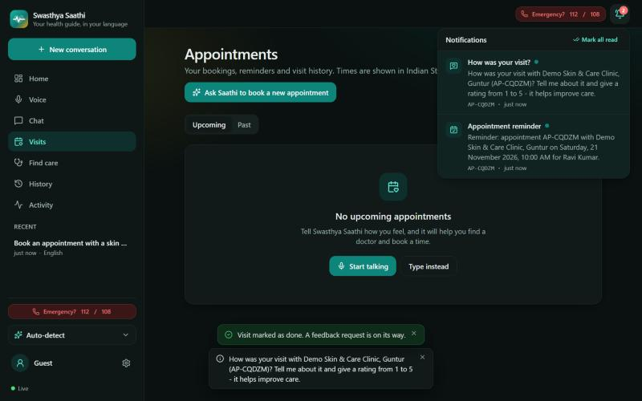

# Swasthya Saathi: a multilingual, voice-first healthcare agent

**Problem:** many people in India struggle to reach healthcare because the apps are in English, the options are confusing, and nobody follows up after a visit.

**Solution:** talk (or type) in your own language. Swasthya Saathi understands you, works out how urgent it is, finds suitable doctors, **books the appointment** (after asking you to confirm), sends **reminders**, schedules **follow-ups** and collects **feedback**, all in one conversation.

```
Initiate   You speak Telugu / Hindi / Tamil / Hinglish...      (Sarvam or Bhashini speech-to-text)
Understand The agent grasps intent + code-mixed language, checks urgency, searches its knowledge base
Assist     Suggests the right specialty, finds providers in your city and language, shows free slots
Execute    Books / cancels / reschedules through tool calls  -> you confirm first
Confirm    Replies in your language with the reference number, date and place   (Sarvam or Bhashini text-to-speech)
Follow up  Reminders (day before + 2 hours before), follow-up reminders, "how was your visit?" feedback
```

**Documentation:** [Architecture](docs/ARCHITECTURE.md) (diagrams, flows, data model, security) · [API reference](docs/API.md) · [Slide deck](docs/Swasthya-Saathi.pptx) · Swagger at `/docs` when the backend runs.

## What it looks like

Real screens from the running app. *These were captured in a test run where a scripted stand-in replaced the language model (no API key was available), so the wording of the assistant's replies is scripted; the interface, backend, database, confirmation gate and reminders are the real thing.*

| Provider search and free slots (IST) | The confirmation gate: nothing is booked until you press Confirm |
|---|---|
|  |  |
| **Visits: booking, masked mobile, reminder timeline** | **Notifications: reminder and feedback request** |
|  |  |

## How it fits together

```
 Browser (React)                                   FastAPI backend                         Outside services
┌──────────────────┐   WAV (16 kHz mono)   ┌──────────────────────────────┐        ┌──────────────────────┐
│ Mic → recorder   │ ───────────────────▶  │ /voice/transcribe ───────────┼──────▶ │ Sarvam / Bhashini STT│
│ waveform, VAD    │ ◀── text ───────────  │                              │        └──────────────────────┘
│ Chat / Voice UI  │ ◀═ WebSocket events ═▶│ Agent loop (orchestrator)    │        ┌──────────────────────┐
│ tool + booking   │   token, tool_start,  │   ├─ LLM (open-source) ──────┼──────▶ │ Groq → Sarvam-105B   │
│ cards, confirm   │   confirmation, …     │   ├─ Tools (validated)       │        │ (automatic failover) │
│ 🔔 reminders     │ ◀── notifications ────│   │  urgency · providers     │        └──────────────────────┘
│ audio player ◀───┼── audio/wav ◀─────────│   │  slots · book · cancel   │        ┌──────────────────────┐
└──────────────────┘   /voice/synthesize ──┼───┘  follow-up · feedback    ├──────▶ │ Sarvam / Bhashini TTS│
                                           │ Reminder scheduler (async)   │        │ Webhook → your HMIS  │
                                           │ PostgreSQL                   │        └──────────────────────┘
                                           └──────────────────────────────┘
```

| | |
|---|---|
| **Frontend** | React 18 · TypeScript · Vite · Tailwind · Framer Motion · React Query · WebSocket streaming |
| **Backend** | FastAPI · Pydantic · async SQLAlchemy · Alembic · PostgreSQL |
| **Speech** | **Sarvam** (Saaras v4 speech-to-text, Bulbul v3 text-to-speech) or **Bhashini**; pick with `SPEECH_PROVIDER` (auto = Sarvam when its key is set). With both configured, the other one is used automatically as a **backup** if the main one fails (`SPEECH_FALLBACK_PROVIDER`: auto / sarvam / bhashini / none) |
| **Brain** | **Groq** (`openai/gpt-oss-120b` by default, free tier) as the primary model with **Sarvam-105B** as automatic fallback; any OpenAI-compatible open-source endpoint works. Native tool calling, rolling memory |
| **Knowledge (RAG)** | Curated health knowledge base: Ayushman Bharat, ABHA, e-Sanjeevani, pregnancy and child health, immunisation, diabetes/BP, TB, mental health, first aid, helplines |

> **Important: real places, no invented doctors.** Hospitals and clinics come from **OpenStreetMap** around the user's city or GPS position (volunteer-edited: phone numbers and hours are often missing). They have **no online booking**, so the app saves a **planned visit** that the clinic has *not* confirmed: the booking screen, reminders and the assistant all say so and offer "call to confirm". Clinics that register with their own schedule ("partner clinics") get real, confirmed slots. Invented sample clinics exist only for demos and tests (`SEED_DEMO_PROVIDERS=true`, off by default). The knowledge base and helplines are real public information, but always confirm on the official site/helpline. This assistant gives guidance, **not diagnosis**.

## Status: what has and has not been verified

| Area | Status |
|---|---|
| Backend logic and all API routes | **647 automated tests**: 646 pass on SQLite (one needs PostgreSQL row locks and is skipped there), the full suite last ran on a real PostgreSQL 17 database before the SMS and phone-notification additions, and all migrations (to 0006) have been applied to it. Frontend: 222 tests, type check and build clean |
| Database schema | Alembic migration applied to PostgreSQL; model-vs-schema drift check is clean |
| Double-booking protection, confirmation gate, reminders, failover | Covered by tests (including two users racing for one slot) |
| Frontend | 79 unit tests, strict type-check and production build pass |
| Full journey in a browser (search → slots → confirm → booking → reminder → feedback request) | **Verified**, with a scripted stand-in LLM, on PostgreSQL |
| Real Groq / Sarvam language models | **Not yet verified**: no API keys were available. Request shapes follow the providers' published docs and are tested against fakes |
| Real voice (microphone, Sarvam/Bhashini speech) | **Not yet verified** for the same reason |
| Real hospital integration, SMS / WhatsApp | Not built: provided as a signed webhook seam |

## What the agent can do (tools)

| Step | Tool | Needs your OK |
|---|---|---|
| Understand urgency | `assess_urgency`: deterministic red-flag rules (chest pain, breathing trouble, stroke signs, bleeding, self-harm, pregnancy danger signs…) → emergency / urgent / routine + suggested specialty. **Emergency → tells you to call 112/108, never books.** | no |
| Discover care | `find_healthcare_providers` (specialty, city, doctor's language, teleconsultation, Ayushman accepted), `check_availability` (real free slots, IST) | no |
| Book | `book_appointment` (validates slot, mobile number, lead time, 14-day horizon, per-user limits; **database-enforced no double-booking**) | **yes** |
| Manage | `list_appointments`, `reschedule_appointment`, `cancel_appointment` | reschedule/cancel: **yes** |
| Follow up | `schedule_follow_up` (reminder on a future date), `record_feedback` (1-5 + comment after the visit) | no |
| Information | `search_knowledge_base`, `lookup_service_directory` (helplines/portals), optional `web_search` | no |
| Paperwork help | `form_assistant` + `submit_service_request` (Ayushman card / ABHA ID callback request) | submit: **yes** |
| Misc | `create_task` / `list_tasks` / `update_task_status`, `set_language` | no |

**Reminders & notifications.** Booking automatically schedules: a reminder 24 h before (if there is time), one 2 h before, and a feedback request 2 h after the visit. A background loop delivers due reminders as in-app notifications (🔔 in the header, spoken aloud if voice is on). Texts are translated into the patient's language by the LLM (falling back to English), and every delivery is also POSTed to `WEBHOOK_URL`, so an SMS/WhatsApp gateway can send them. Several backend workers can run the loop safely (rows are claimed with `FOR UPDATE SKIP LOCKED`).

## Run it (Windows / PowerShell)

You need Python 3.11+, Node 20+, and PostgreSQL 14+.

### 1. Backend

```powershell
cd backend
py -3.11 -m venv .venv
.\.venv\Scripts\python.exe -m pip install -r requirements-dev.txt
copy .env.example .env          # then fill it in (step 3)
```

Create the database and apply the schema:

```powershell
& "C:\Program Files\PostgreSQL\17\bin\createdb.exe" -U postgres voiceagent
.\.venv\Scripts\alembic.exe upgrade head
```

Start the API (it seeds the knowledge base and helplines on first start; no sample clinics):

```powershell
.\.venv\Scripts\python.exe -m uvicorn app.main:app --reload --port 8000
```

Open <http://localhost:8000/docs>. `GET /api/v1/health` shows which integrations are configured.

### 2. Frontend

```powershell
cd frontend
npm install
npm run dev
```

Open <http://localhost:5173>. The dev server proxies `/api` (including the WebSocket) to port 8000.

### 3. Configure `backend/.env`

| Variable | What to put |
|---|---|
| `DATABASE_URL` | `postgresql+asyncpg://postgres:<password>@localhost:5432/voiceagent` (encode special characters in the password, e.g. `@` → `%40`) |
| `JWT_SECRET` | `python -c "import secrets; print(secrets.token_urlsafe(48))"` |
| `SARVAM_API_KEY` | From dashboard.sarvam.ai. Gives you speech (STT + TTS) and the fallback LLM |
| `LLM_API_KEY` | Your Groq key (console.groq.com). Defaults: `LLM_BASE_URL=https://api.groq.com/openai/v1`, `LLM_MODEL=openai/gpt-oss-120b` |
| `LLM_FALLBACK_BASE_URL`, `LLM_FALLBACK_API_KEY`, `LLM_FALLBACK_MODEL` | `https://api.sarvam.ai/v1`, your Sarvam key, `sarvam-105b-conversations`: used automatically when Groq is rate-limited, down or rejects the key |
| `BHASHINI_USER_ID`, `BHASHINI_ULCA_API_KEY` | Bhashini speech. Use it as the main provider (`SPEECH_PROVIDER=bhashini`) or as the backup for Sarvam; with both keys set, whichever is not the main one backs it up |
| `RAZORPAY_KEY_ID`, `RAZORPAY_KEY_SECRET`, `RAZORPAY_WEBHOOK_SECRET`, `RAZORPAY_PLAN_MONTHLY` (+ `RAZORPAY_PLAN_YEARLY`) | Optional **Saathi Plus** subscription via Razorpay. Blank = the app stays free and unlimited. With them set the free plan gets daily limits (`FREE_DAILY_MESSAGES`=25, `FREE_DAILY_CALLS`=2) and Plus removes them; SOS and reminders are never limited. Use `rzp_test_` keys first. Create plans with `scripts\create_razorpay_plans.py`, then add the webhook `https://YOUR-HOST/api/v1/billing/webhook` (events: `subscription.activated, charged, pending, halted, cancelled, completed, paused, resumed`) using the same secret as `RAZORPAY_WEBHOOK_SECRET`. Card and UPI details go only to Razorpay |
| *(no setting)* | **Medical shops** (Find care, "Medical shops" chip, and "find a medical shop near me" by voice), **daily medicine reminders** (Medicines page, or say "remind me to take my BP tablet at 8"; they also pop up on the phone), **thumbs up/down on replies** (review the bad ones with `scripts\export_flagged_answers.py`), **Share** on an appointment (the phone's share sheet or WhatsApp; the patient's mobile number is never included) and a **Health timeline** of all visits per family member |
| `GOOGLE_MAPS_API_KEY`, `PLACES_PROVIDER` | Optional **Google Maps** (Places API, new) as the first source for hospitals, clinics and medical shops; ratings and Google Maps links are shown. Any Google failure falls back to OpenStreetMap automatically. Needs "Places API (New)" enabled and billing on in Google Cloud. Blank = OpenStreetMap only |
| *(no setting)* | **Symptom check-in** (the day after Saathi rates your symptoms, a notification asks how you are now; one at a time, none for emergencies, switch off in Settings → Reminders), **child vaccine tracker** (Vaccines page: India's UIP schedule from the child's date of birth, tick visits, reminders before each, the assistant knows what is due) and a **Doctor note** button in the chat (a plain-language note for the clinic from your own words; the assistant never adds facts, diagnosis or doses) |
| `RESPONSE_VALIDATION_ENABLED`, `RESPONSE_VALIDATION_RETRY` | **Response validation** before a reply is spoken or shown: invented phone numbers, fees and references, medicine doses, diagnoses, leaked instructions and the wrong language are caught; one rewrite, else a safe localized fallback. Spoken replies are held back until checked. On by default. See `docs/VOICE_PIPELINE.md` |
| `INTENT_LLM_ENABLED`, `INTENT_TIMEOUT_SECONDS` | **Intent classification**: fast rules (English, Hinglish, main Indian-language emergency words) decide what the person wants; one short model call handles other scripts or unclear messages and also returns the knowledge-base query. A possible emergency puts a "call 112 first" instruction at the top of the prompt, in code. On by default |
| `RAG_ENABLED`, `RAG_MIN_SCORE`, `RAG_TOP_K` | **Retrieval**: the best-matching verified notes (and the person's upcoming visits) are given to the model on every turn, so health and scheme answers come from the knowledge base. On by default |
| `PUSH_ENABLED`, `VAPID_PRIVATE_KEY`, `VAPID_SUBJECT` | **Phone notifications** (Web Push) are on by default and need no keys: the signing key is derived from `JWT_SECRET`, so keep that stable. Optional: `VAPID_SUBJECT` = a real `mailto:` contact. Each phone opts in under Settings → Reminders |
| `TWILIO_ACCOUNT_SID`, `TWILIO_AUTH_TOKEN`, `SMS_FROM` | Optional **SMS reminders** via Twilio (`SMS_FROM` = your Twilio number or a `MG…` Messaging Service id). Each person still opts in under Settings → Reminders; texts go only to the mobile number given for that visit, once per reminder, and a failed text never blocks the in-app reminder |
| `WEBHOOK_URL` / `WEBHOOK_SECRET` | Optional: your hospital system / SMS gateway |
| `DEMO_MODE` | `true` only to show the "simulate visit / remind now" demo buttons; default `false` |
| `AGORA_APP_ID`, `AGORA_APP_CERTIFICATE` | Agora Console, your project (App ID + Primary Certificate). Enables **live voice calls** |
| `MURF_API_KEY` | Murf API key: Murf Falcon speaks the live-call replies. Check the voices with `scripts\check_murf_voices.py` |
| `AGORA_PUBLIC_URL` | `https://...` address of this server that Agora's cloud can reach (ngrok / cloudflared tunnel). With it the voice agent can use every tool; without it, it can only chat |

**Easiest way to enter keys safely:** run the helper. It asks for the keys with hidden input, writes them to the right file without a byte-order mark, and prints only how many characters each has.

```powershell
powershell -NoProfile -ExecutionPolicy Bypass -File backend\scripts\set_keys.ps1
```

**Restart the backend after changing `.env`**: settings are read once at startup. All options are in [`backend/.env.example`](backend/.env.example). **No key is hardcoded anywhere**; `.env` is git-ignored. Without a speech key the app works in text; without any LLM key chat returns a clear "AI model is not set up" message. `GET /api/v1/health` and the Settings screen show which provider is active.

**Using Groq and Sarvam together.** Groq is fast and its free tier is generous, but it has per-minute token caps; Sarvam-105B is an Indian-language specialist billed from signup credits. With both configured, each chat turn goes to Groq first and falls over to Sarvam on a rate limit, outage, timeout or bad key (the answering model is recorded on every run, visible in Activity). Reminder translation, titles and memory summaries use the same chain. Sarvam limits to know: speech-to-text accepts **up to 30 seconds** per recording (the app caps recording automatically), and Bulbul can *speak* 11 languages (Hindi, English, Bengali, Gujarati, Kannada, Malayalam, Marathi, Odia, Punjabi, Tamil, Telugu); Assamese, Urdu and Sanskrit can be understood but are answered in text only.

### Live voice call (Agora Conversational AI + Murf Falcon)

The **Live call** screen (`/call`) joins an Agora channel with a cloud voice agent: Agora does turn-taking and speech-to-text, **this server is the agent's brain** (OpenAI-compatible `/api/v1/agora/llm/chat/completions`), and **Murf Falcon** speaks the replies in 10 languages (en, hi, te, ta, kn, ml, bn, mr, gu, pa). Each spoken turn runs through the same assistant as the text chat: it can find real clinics, plan a visit, use family profiles, and a **spoken "yes" or "no" answers the confirm-before-acting question**.

1. Put `AGORA_APP_ID`, `AGORA_APP_CERTIFICATE` and `MURF_API_KEY` in `backend/.env`.
2. Agora's cloud must reach your backend: run a tunnel (for example `cloudflared tunnel --url http://localhost:8000` or `ngrok http 8000`) and set `AGORA_PUBLIC_URL=https://<the address it prints>`. Skip this and the agent still talks, but through Groq directly and without tools.
3. Restart the backend; open **Live call**, choose a language and press **Start call**.

What is verified: the Murf key and all 10 voices (live), the exact request sent to Agora and the call-token security (automated tests with a fake Agora). **Not yet verified against a real Agora project** until its credentials are in `.env`.

### Try this demo script

1. Open **AI Consult** (or start a **Live call**), pick **Telugu**, and say (or type): *"నాకు చర్మం మీద దద్దుర్లు ఉన్నాయి, గుంటూరులో డాక్టర్ కావాలి"*. You can also say *"open the doctors page for Guntur"* or *"switch to dark mode"* and the app does it (the assistant's `control_app` tool).
2. The agent checks urgency and lists **real** clinics and hospitals near Guntur (from OpenStreetMap, nearest first, with a phone number when one is listed).
3. Pick one, give a day and time, a name and a mobile number; the agent reads the details back, and a **confirmation card** appears. Approve it. It is saved as a **planned visit** that the clinic has not confirmed, and the app says so and offers **Call to confirm**.
4. You get the reference number (e.g. AP-7K3QX) in Telugu, both spoken and on screen. Open **Care Plan** to see it and its scheduled reminders. Add a family member under **Family** to book for them.
5. With `DEMO_MODE=true` the demo buttons **Send reminder now** and **Simulate visit done** show the 🔔 notification and the feedback request; reply with a rating and the agent records it.
6. Try *"I have severe chest pain"*: it tells you to call 112 immediately and does not book. Tap the red **SOS** button for numbers, first aid, your emergency contacts and the nearest hospitals.

### Troubleshooting

| Symptom | Cause and fix |
|---|---|
| "The AI model is not set up yet" | `LLM_API_KEY` (and/or the fallback key) is empty in `backend/.env`, or the backend was not restarted after you saved it. Check `GET /api/v1/health` → `llm_configured` |
| Settings shows speech "Not set up" | `SARVAM_API_KEY` empty (or Bhashini keys, if `SPEECH_PROVIDER=bhashini`). Restart the backend |
| Microphone does nothing | Browsers allow the mic only on `localhost` or HTTPS, and only after you grant permission. Typing always works |
| Voice recording stops by itself | Sarvam speech-to-text allows 30 s per recording (Bhashini 60 s); shorter, then press send |
| Backend fails at start with a database error | Check `DATABASE_URL` (user, password with `%40`-style encoding, database name) and that `alembic upgrade head` ran |
| `502 llm_rate_limited` / `llm_no_credits` | Free tier limit or empty credits on the provider; add the fallback model or wait |
| Vite shows "Failed to load PostCSS config … not valid JSON" | A JSON file got a byte-order mark (PowerShell 5 `-Encoding utf8` adds one). Re-save without BOM and restart `npm run dev` |
| Changed `.env` but nothing changed | Restart the backend (settings load once) |

## Run the tests

```powershell
cd backend
.\.venv\Scripts\python.exe -m pytest                 # 646 pass + 1 skipped (PostgreSQL-only); SQLite in memory, no keys or network
```

Run the same suite on **PostgreSQL** (use a dedicated database whose name ends in `_test`; its tables are dropped before every test, and the run refuses any other name):

```powershell
$env:TEST_DATABASE_URL = "postgresql+asyncpg://postgres:<password>@localhost:5432/voiceagent_test"
.\.venv\Scripts\python.exe -m pytest                 # 647 pass expected, including the row-locking test for the reminder loop
```

```powershell
cd ..\frontend
npm test                                              # 191 tests
npm run typecheck ; npm run build
```

Backend tests use **fake** LLM, Sarvam and Bhashini servers. They cover every endpoint, the full symptoms-to-booking journey, urgency rules, double-booking protection (including two users racing for one slot), the confirmation gate, cancel/reschedule, reminder delivery over simulated time, follow-ups, feedback, translation of reminders, webhooks, provider selection and Groq→Sarvam failover, multilingual/code-mixed handling, WebSocket streaming, failures/retries, rate limiting, parallel requests, and that the Alembic migration matches the models.

## How it works (plain language)

1. You speak. The browser records 16 kHz mono WAV and sends it to `/voice/transcribe`; the speech provider returns text you can edit before sending (or enable auto-send).
2. The text goes to the agent over a WebSocket. The backend saves it, decides the language, and builds a prompt: rules + recent messages + a rolling summary of older ones.
3. The open-source LLM streams its answer. When it needs data or an action it asks for a **tool**; the backend validates the request, runs it, saves the result in PostgreSQL, and lets the model continue (max 5 steps). Sensitive tools **pause for your confirmation**.
4. The answer streams word by word; in voice mode each finished sentence goes to text-to-speech and plays immediately.

**Languages.** Pick one, or choose *Auto-detect*: the backend reads the script of what you typed (Telugu script → Telugu) and keeps the conversation language for Latin-script text, which is what makes code-mixed input like "ration card documents enti?" work. The model replies in your language in its native script and understands mixed input. Asking "speak in Tamil" calls `set_language`.

**Safety by design**
* The model can only call registered tools: no SQL, shell or open HTTP. Arguments are validated by Pydantic; every tool is scoped to the signed-in user.
* **Business rules are code, not prompts**: slot validity, double-booking (a partial unique index in the database), appointment limits, mobile format, red-flag urgency rules. The model cannot talk its way around them.
* **Sensitive actions need your OK**, and are re-validated after you approve. Moving on without answering cancels the pending action.
* Tool results and web pages are treated as data, never instructions. Uploads are checked (format, size, duration). Rate limiting, CORS allow-list, JWT auth, request IDs in logs (never message or audio bodies; the WebSocket token is redacted). Voice audio is processed in memory and **not stored**. Mobile numbers are masked in API responses.

**Key decisions** (full table in [Architecture §13](docs/ARCHITECTURE.md#13-decisions-and-known-limits))
* *Own agent loop instead of LangGraph*: one decision point ("did the model ask for tools?"), so a plain loop with a step limit is shorter and easier to test and stream.
* *Any OpenAI-compatible LLM endpoint with automatic failover*: Groq ↔ Sarvam ↔ OpenRouter ↔ local Ollama are environment variables; no paid API is required.
* *Availability computed from weekly schedules* minus booked slots, so there is no slot table to keep in sync.
* *Reminders are rows + a poll loop*, not an in-memory timer: they survive restarts and run identically on any host.
* *WAV recorded in the browser*, so no ffmpeg is needed on the server.
* *Guest accounts with JWT*: each browser gets a real account instantly; it can be upgraded to email/password later without losing data.
* *Lexical RAG first*: the knowledge base is small and curated; `KnowledgeRepository.search()` is the one place to swap in pgvector.

## Project layout

```
backend/
  app/main.py                    app factory, middleware, error handlers
  app/api/routes/                health, auth, conversations, chat (REST + WebSocket), voice, agents,
                                 appointments, providers, notifications, tasks, preferences, dashboard
  app/agents/                    orchestrator.py (agent loop), tools.py (18 tools + registry), triage.py (urgency rules),
                                 forms.py, prompts.py
  app/services/                  agent_service, appointments (booking rules), scheduling (slots), reminder_service,
                                 llm_service (targets + failover), speech_service, sarvam_service, bhashini_service, webhooks
  app/database/                  models.py, repositories/, seed.py, connection.py
  app/core/, app/middleware/     config, security, errors, logging (token redaction); rate limit, request context
  migrations/                    Alembic (0001 initial schema)
  scripts/set_keys.ps1           safe key entry helper
  tests/                         pytest suite with fake LLM / speech servers
frontend/src/
  pages/                         Dashboard, Voice, Chat, Appointments (Visits), Find care, History, Activity, Settings, Language settings
  components/                    chat (bubbles, tool cards), voice (orb, waveform), health (appointment card, notification bell), layout, ui
  hooks/ + lib/                  ChatProvider, chatReducer, chatSocket (reconnect + REST fallback), recorder, vad, wav, speech streaming
  api/                           typed client with guest bootstrap, endpoint functions, react-query hooks
docs/
  ARCHITECTURE.md                diagrams, flows, data model, security, deployment, extension guide
  API.md                         endpoint and WebSocket reference
  Swasthya-Saathi.pptx           slide deck
  assets/                        screenshots
```

## Database tables

15 tables: `users`, `user_preferences`, `language_preferences`, `conversations`, `conversation_metadata`, `messages`, `agent_executions`, `tool_execution_logs`, the healthcare tables `providers`, `appointments` (with the double-booking guard) and `reminders`, plus `tasks`, `knowledge_documents` / `knowledge_chunks` (RAG) and `service_directory` (helplines). Foreign keys cascade on delete, hot paths are indexed, timestamps are timezone-aware UTC. ER diagram: [Architecture §6](docs/ARCHITECTURE.md#6-data-model).

## Limitations (honest notes)

* Places are real (OpenStreetMap) but unconfirmed: a visit at one is a *planned* visit. Confirmed slots need a partner clinic's schedule or an integration behind `WEBHOOK_URL` (events: `appointment.booked|cancelled|rescheduled|feedback`, `reminder.delivered`, `service_request.submitted`).
* Reminders are in-app (+ webhook). Sending actual SMS/WhatsApp needs a gateway on the webhook.
* The Sarvam client follows Sarvam's published REST docs (STT `saaras:v4`, TTS `bulbul:v3`, chat `sarvam-105b-conversations`) and the Bhashini client follows the public ULCA/Dhruva pipeline API. Neither has been exercised against the live services yet (no keys were available while building); both are covered by tests against fake servers that check the documented request shapes. Model/speaker names and free-credit amounts change, so confirm them in each provider's dashboard.
* Live checks done with real keys: Bhashini and Sarvam speech both round-trip text → audio → text in 11 languages, Groq `openai/gpt-oss-120b` answers and calls tools, and the Groq → Sarvam failover triggered on a real 429 and a bad key. `sarvam-105b-conversations` also returned correct tool calls in single-step tests (a full multi-step booking through it has not been run). Groq retired `llama-3.3-70b-versatile`, so the default is now `openai/gpt-oss-120b`; check `https://api.groq.com/openai/v1/models` if a model name stops working. If Sarvam tool calls misbehave, set `LLM_FALLBACK_MODEL=sarvam-105b` with `LLM_FALLBACK_EXTRA_BODY={"reasoning_effort": null}`.
* Rate limiting is in-memory per process; use Redis or your gateway behind several workers.
* Urgency rules are deliberately conservative and simple; they are a safety net, not clinical triage. Have clinicians review them before real-world use.
* SQLite works for development and tests only; use PostgreSQL for anything shared.
* Hackathon note: voice conversations are the **Live call** screen (Agora Conversational AI with Murf Falcon voices). The chat box still has a mic for dictation, which uses Bhashini / Sarvam speech (behind the `SpeechProvider` interface, so adding another provider is a single-file change). The earlier separate Voice screen was removed as a duplicate of Live call; `/voice` now redirects to `/call`.
* **The assistant can drive the app.** The `control_app` tool opens a page (home, chat, doctors, care plan, family, SOS, history, activity, settings, language settings, live call; for doctors an optional city starts the search) or switches light/dark theme, from the chat or a live call. The browser checks every instruction against a fixed list of pages and never follows anything else. During a live call, opening another page would end the call, so the app asks first. Not built: keeping a call running while the pages change.

## Deploy (GitHub + Render)

One Docker image serves the API and the web app together (`Dockerfile`), and `render.yaml` describes the Render service and its PostgreSQL database.

1. Push the repository to GitHub (`.env` files are git-ignored; `backend/.env.example` holds no secrets).
2. In Render choose **New → Blueprint**, pick the repository, and apply. Render builds the image, creates the database and runs the migrations on start.
3. Render asks for the keys marked `sync: false` in `render.yaml`: `LLM_API_KEY` (Groq), `LLM_FALLBACK_API_KEY` and `SARVAM_API_KEY` (Sarvam), `BHASHINI_USER_ID`, `BHASHINI_ULCA_API_KEY`, `AGORA_APP_ID`, `AGORA_APP_CERTIFICATE`, `MURF_API_KEY`. Keys never go into the repository.
4. Live calls need no tunnel on Render: its own address (`RENDER_EXTERNAL_URL`) is used for `AGORA_PUBLIC_URL` automatically.

Free-plan limits to know: the service sleeps after 15 minutes without traffic (the first request afterwards takes about a minute, and reminders are only delivered while it is awake), and the free database is deleted after 30 days. Use paid plans for anything lasting. The Docker image has not been built on the development machine (Docker was not running); its steps were checked separately: a fresh install of `requirements.txt`, the production web build, and the app serving that build.
