# Architecture

How Swasthya Saathi is put together, why, and how a request moves through it. Diagrams use [Mermaid](https://mermaid.js.org/) (rendered by GitHub, VS Code's Markdown preview and most Markdown viewers). A slide version of the same material is in `Swasthya-Saathi.pptx`.

**Picture version** (for viewers that do not render Mermaid): [system overview](assets/architecture-overview.png) · [the agent loop](assets/agent-loop.png) · [data model](assets/data-model.png)

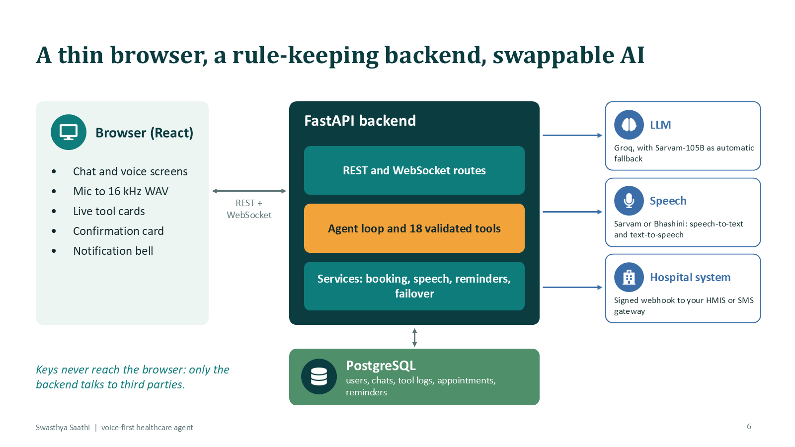

**Contents:** [1. What it is](#1-what-it-is) · [2. System context](#2-system-context) · [3. Layers](#3-layers-and-the-one-rule) · [4. Key flows](#4-key-flows) · [5. The agent loop](#5-the-agent-loop) · [6. Data model](#6-data-model) · [7. State machines](#7-state-machines) · [8. Security](#8-security-model) · [9. Failure handling](#9-failure-handling) · [10. Configuration](#10-configuration-map) · [11. Deployment](#11-deployment) · [12. Extending it](#12-extending-it) · [13. Decisions & limits](#13-decisions-and-known-limits)

---

## 1. What it is

A **voice-first healthcare assistant**. A person speaks or types in their own language; an LLM-driven *agent* understands the request and uses a small set of **validated tools** to act: assess urgency, find providers, book / change / cancel appointments, schedule follow-ups, collect feedback. Anything that changes data waits for the user's explicit confirmation.

Design goals, in priority order:

1. **Safe** - emergencies are never booked; the model cannot bypass business rules or invent data it was not given.
2. **Accessible** - any supported Indian language, by voice or text, on a phone browser.
3. **Understandable** - plain layers, one place per rule, every agent action recorded.
4. **Swappable** - the LLM, the speech provider and the hospital directory are all replaceable behind small interfaces.

Not goals: clinical diagnosis, payments, real hospital integration (that is the webhook seam, see [§11](#11-deployment)).

## 2. System context

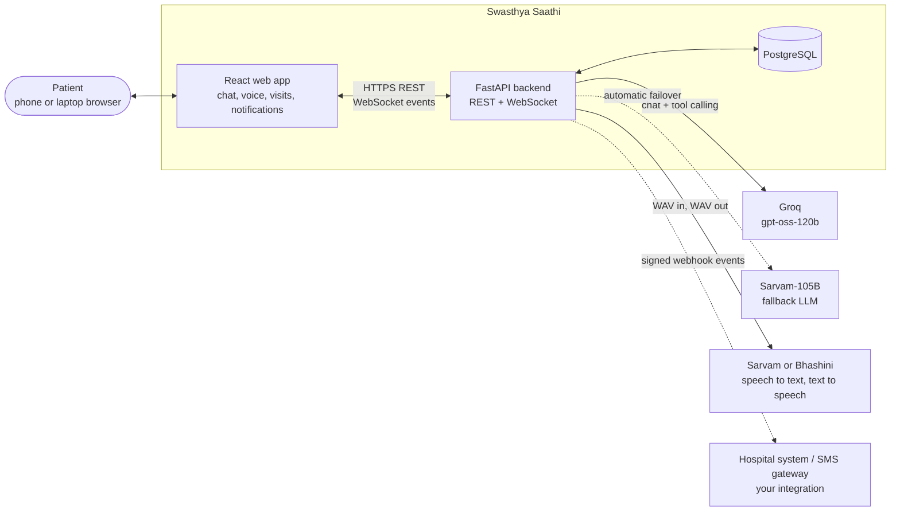

Solid arrows are used on every turn; dotted ones are optional or only on failure. Only the backend talks to third parties, so **no API key ever reaches the browser**.

## 3. Layers and the one rule

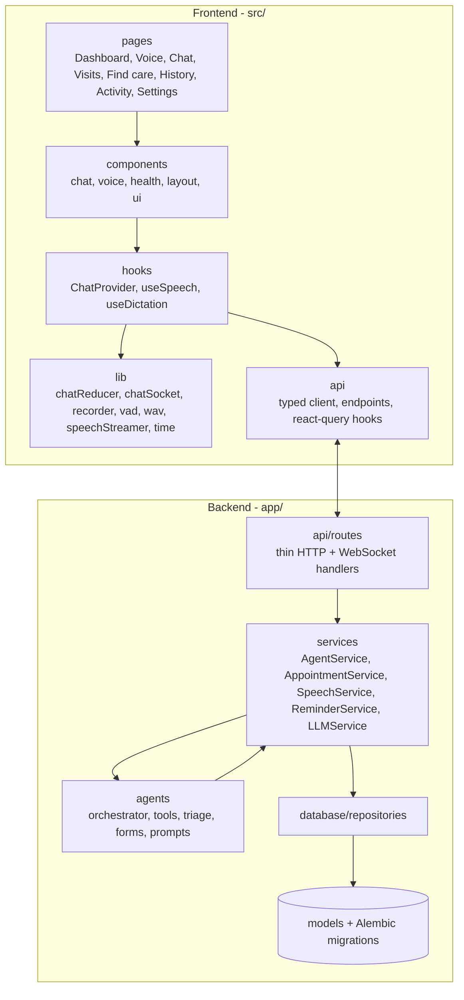

**The one rule:** *business rules live in `services/` and `agents/triage.py`, never in a prompt and never in a route.* The REST API and the agent tools both call the same `AppointmentService`, so the UI's "Cancel" button and the model's `cancel_appointment` tool obey identical rules (ownership, state, limits, double-booking). Routes only translate HTTP; the model only chooses *which* tool to ask for.

| Layer | Responsibility | Examples |
|---|---|---|
| `api/routes` | Parse/validate input, auth, map errors to HTTP | `chat.py`, `appointments.py`, `voice.py` |
| `services` | Business rules and orchestration of one use case | booking, reminders, speech chunking/caching, failover |
| `agents` | The LLM loop, tool registry, deterministic safety rules | `orchestrator.py`, `tools.py`, `triage.py` |
| `database` | Persistence only; no rules | models, repositories, seed data |
| `core` / `middleware` | Cross-cutting | config, JWT/scrypt, errors, rate limit, request id, log redaction |

## 4. Key flows

### 4.1 One voice turn

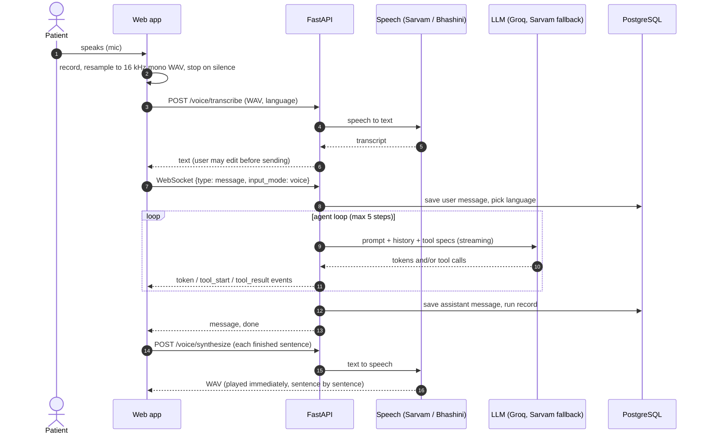

Notes: audio is processed in memory and never stored; the browser starts speaking as soon as the first sentence completes, not after the whole answer.

### 4.2 Booking with the confirmation gate

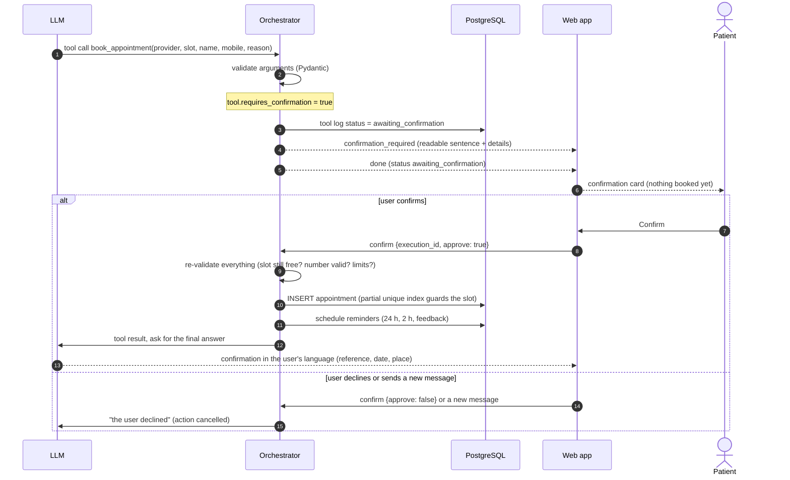

The slot guard is a **database constraint**, not application code: two people confirming the same slot at the same instant cannot both succeed, and the loser gets a clear "slot was just taken" message.

### 4.3 Reminders and follow-up

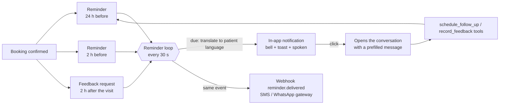

Reminders are **rows in PostgreSQL plus a polling loop**, not in-memory timers, so they survive restarts. The loop claims due rows with `FOR UPDATE SKIP LOCKED`, so running several backend workers cannot deliver the same reminder twice. It also marks finished visits as completed, and silently drops "your appointment is soon" reminders whose time has already passed.

### 4.4 LLM failover

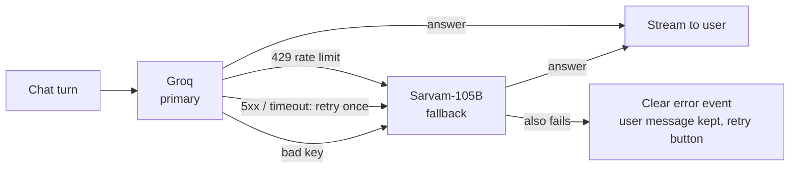

Failover only happens **before the first token is streamed**; once text has reached the user the turn is never silently switched. The model that actually answered is stored on every run and shown in the Activity page.

## 5. The agent loop

`agents/orchestrator.py`: a plain loop with a hard step limit (default 5), deliberately not a graph framework - there is one decision ("did the model ask for tools?").

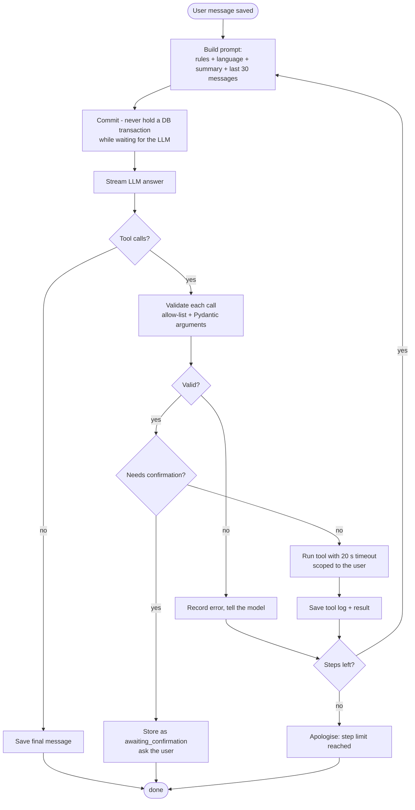

What the model can and cannot do:

| The model can | The model cannot |
|---|---|
| Choose among the 18 registered tools and fill their arguments | Run SQL, shell commands or free-form HTTP |
| Phrase answers in the user's language | Skip validation, confirmation or slot/limit checks |
| Explain what it is about to do | Act on another user's data (every tool is scoped to the signed-in user) |
| Ask a clarifying question | Treat tool output or web text as instructions (stated in the system prompt) |

### Tool inventory

| Group | Tools | Confirmation |
|---|---|---|
| Understand | `assess_urgency` (deterministic red-flag rules → emergency / urgent / routine + specialty) | no |
| Discover | `find_healthcare_providers`, `check_availability` | no |
| Act | `book_appointment`, `reschedule_appointment`, `cancel_appointment` | **yes** |
| Follow up | `schedule_follow_up`, `record_feedback`, `list_appointments` | no |
| Information | `search_knowledge_base` (TF-IDF RAG), `lookup_service_directory`, `web_search` (optional) | no |
| Paperwork | `form_assistant`, `submit_service_request` | submit: **yes** |
| Misc | `create_task`, `list_tasks`, `update_task_status`, `set_language` | no |

## 6. Data model

15 tables. Timestamps are timezone-aware UTC; clinic times are rendered in IST (`Asia/Kolkata`).

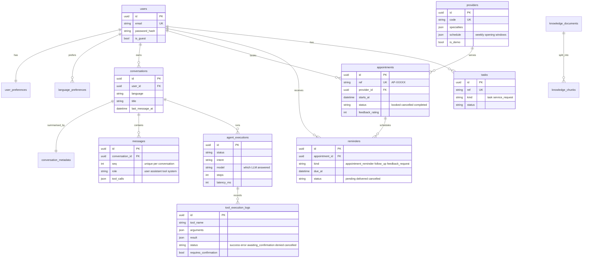

Also: `service_directory` (national helplines/portals, read-only for the agent) and `knowledge_documents` / `knowledge_chunks` (RAG corpus).

Design points worth knowing:

- **No slot table.** Free slots = the provider's weekly `schedule` expanded for the next 14 days, minus booked rows. Nothing to keep in sync.
- **Double-booking guard** - `UNIQUE (provider_id, starts_at) WHERE status = 'booked'`, a partial index (PostgreSQL and SQLite). Cancelled appointments free the slot automatically.
- **`messages.seq`** gives a stable order even when two rows share a timestamp.
- **`tool_execution_logs`** plus **`agent_executions`** are the audit trail: what the agent did, with which arguments, how long it took, which model answered.
- **JSON columns** (tool calls, arguments, schedules) keep the schema portable between PostgreSQL and SQLite for tests.

## 7. State machines

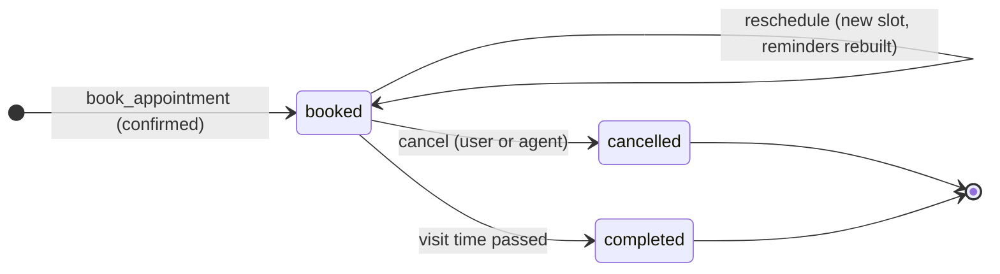

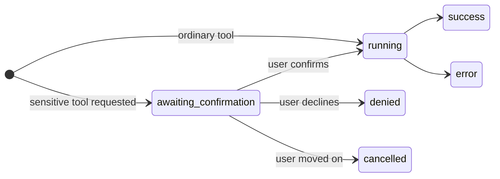

## 8. Security model

| Threat | Control |
|---|---|
| Model invents an action or data | Tool allow-list; Pydantic argument validation; rules re-checked at execution time |
| Model books without consent | `requires_confirmation` gate; re-validation after approval; stale confirmations are cancelled when the user moves on |
| Prompt injection via tool output / web text | Outputs are data; system prompt forbids following instructions inside them; no tool can reach arbitrary URLs |
| Emergency handled badly | Deterministic `triage.py` rules (not the model); emergency never reaches booking |
| Access to another person's data | Every query is scoped to the JWT user; foreign ids return 404; mobile numbers are masked in API responses |
| Double booking race | Database partial unique index inside a savepoint |
| Credential leakage | Keys only in `backend/.env` (git-ignored); never sent to the browser; JWT in WebSocket URL is redacted from logs |
| Abuse / cost | Per-IP rate limits (general 240/min, AI endpoints 40/min); upload checks for format, size and duration; one chat turn at a time per socket |
| Sensitive data at rest | Voice audio is never stored; logs hold ids and timings, not message text; passwords are scrypt hashes |
| Webhook spoofing | HMAC-SHA256 signature in `X-Signature` |

Honest gaps: authentication is JWT + guest accounts (no OTP / identity proofing); rate limiting is per process; the urgency rules are a safety net, not clinical triage (see [§13](#13-decisions-and-known-limits)).

## 9. Failure handling

| What fails | What the user sees / what happens |
|---|---|
| Primary LLM rate-limited or down | Automatic failover to the fallback model; run records which model answered |
| Both LLMs fail | Error message with a Retry button; the user's message is kept; **Regenerate** re-asks |
| No LLM key | Clear "AI model is not set up" message naming the setting to fill in |
| Speech provider fails / no key / audio too long | Voice shows a readable message and offers typing; text chat is unaffected |
| Model returns a malformed tool call | One retry without tools; otherwise an error result goes back to the model so it can correct itself |
| Tool throws or times out (20 s) | Recorded as an error result; the conversation continues |
| Runaway tool loop | Hard stop after 5 steps with a polite message |
| Slot taken between "offer" and "confirm" | Tool error "slot was just taken"; the agent offers other slots |
| WebSocket drops | Auto-reconnect with back-off; REST fallback for sending |
| Webhook down | Logged and ignored; never blocks a booking or reminder |
| Server restart | Reminders survive (they are rows); in-flight turns are cancelled, the user message is kept |

## 10. Configuration map

All settings are environment variables read by `app/core/config.py` (see `backend/.env.example`).

| Concern | Variables |
|---|---|
| Database | `DATABASE_URL`, `AUTO_CREATE_TABLES`, `AUTO_SEED` |
| Auth | `JWT_SECRET`, `ACCESS_TOKEN_MINUTES` |
| Speech | `SPEECH_PROVIDER` (auto / sarvam / bhashini), `SPEECH_FALLBACK_PROVIDER` (auto / sarvam / bhashini / none: the backup tried when the main provider errors), `SARVAM_*`, `BHASHINI_*` |
| LLM primary | `LLM_BASE_URL`, `LLM_API_KEY`, `LLM_MODEL`, `LLM_EXTRA_BODY` |
| LLM fallback | `LLM_FALLBACK_BASE_URL`, `LLM_FALLBACK_API_KEY`, `LLM_FALLBACK_MODEL`, `LLM_FALLBACK_EXTRA_BODY` |
| Integration | `WEBHOOK_URL`, `WEBHOOK_SECRET` |
| Behaviour | `AGENT_MAX_STEPS`, `REMINDER_POLL_SECONDS`, `BOOKING_HORIZON_DAYS`, `MAX_ACTIVE_APPOINTMENTS`, `DEMO_MODE` |
| Limits | `MAX_AUDIO_BYTES`, `MAX_AUDIO_SECONDS`, `RATE_LIMIT_PER_MINUTE`, `RATE_LIMIT_AI_PER_MINUTE` |

The frontend needs no configuration in development (`/api` is proxied to port 8000). `VITE_API_BASE` is only for a different origin.

## 11. Deployment

| Stage | Setup |
|---|---|
| **Local / demo** (this repo) | Vite dev server :5173 → proxy → uvicorn :8000 → PostgreSQL. `DEMO_MODE=true` shows sample providers and the demo buttons |
| **Pilot** | Build the frontend (`npm run build`), serve `dist/` and the API behind one reverse proxy with **HTTPS** (browsers only allow the microphone on `localhost` or HTTPS); `DEMO_MODE=false`; `ENVIRONMENT=production` (refuses the default JWT secret) |
| **Scale-out** | Several uvicorn workers behind a load balancer. The reminder loop is safe on every worker (row locks). Move rate limiting to Redis or the gateway (it is per process today) |

Plugging in a real hospital: replace the seeded `providers` rows with your directory (or sync them), and point `WEBHOOK_URL` at an adapter that receives `appointment.booked|cancelled|rescheduled|feedback`, `reminder.delivered` and `service_request.submitted` events and writes them into your HMIS or sends the SMS / WhatsApp message.

## 12. Extending it

| To... | Do this |
|---|---|
| **Add a tool** | Subclass `Tool` in `agents/tools.py` with a Pydantic `params` model, set `requires_confirmation` if it changes data, put business rules in a service, register it in `build_registry()`. The UI shows unknown tools generically; add a card in `components/chat/ToolResults.tsx` for a richer view |
| **Change the LLM** | Set `LLM_BASE_URL` / `LLM_MODEL` (any OpenAI-compatible endpoint with tool calling). Add a second one as the fallback |
| **Add a speech provider** | Implement the five-method `SpeechProvider` protocol in `services/speech_service.py` (`supports`, `transcribe`, `synthesize`, `configured`, `aclose`) and select it in `main.py` |
| **Add a language** | Add it to `utils/language.py` (code, names, script range) and the provider's code map; the language selector and prompts pick it up |
| **Better retrieval** | Replace `KnowledgeRepository.search()` (TF-IDF) with pgvector or full-text search; the tool does not change |
| **Add a form** | Add a spec to `agents/forms.py`; validation is code, not prompt |
| **Add a screen** | Page in `frontend/src/pages`, route in `App.tsx`, nav entry in `components/layout/nav.ts`, endpoint in `api/endpoints.ts` |

## 13. Decisions and known limits

| Decision | Why | Trade-off |
|---|---|---|
| Own agent loop, not LangGraph | One decision point; simpler to test and stream | Move to a graph later if flows branch |
| Rules in services, not prompts | Cannot be talked around; one implementation for UI and agent | More code than "let the model decide" |
| Deterministic urgency check | Auditable, conservative, instant | Keyword rules miss unusual phrasing; needs clinician review before real use |
| Slots computed, not stored | Nothing to sync | Per-request computation (cheap at this scale) |
| Reminders as rows + poll | Survive restarts, host-independent | Up to one poll interval (30 s) of delay |
| WAV recorded in the browser | No ffmpeg on the server | Larger uploads (bounded by 10 MB / provider limit) |
| TF-IDF retrieval | No extra service for a small curated corpus | Lexical only; English queries |
| Guest accounts | Zero-friction start, upgradeable to email | No identity proofing yet |

**Known limits (read before a pilot):**
- Providers are **sample data**; the booking flow is real, the clinics are not.
- Sarvam and Bhashini clients follow the providers' published docs and are covered by fake-server tests; they have not yet been exercised against the live services in this repository.
- `sarvam-105b-conversations` returned valid tool calls in single-step live tests; a full multi-step booking through it has not been run.
- Sarvam speech-to-text accepts at most 30 s per recording; Sarvam can speak 11 languages (Assamese, Urdu, Sanskrit are answered in text).
- Notifications are in-app plus webhook; actual SMS/WhatsApp needs a gateway behind the webhook.
- Rate limits are per process.
